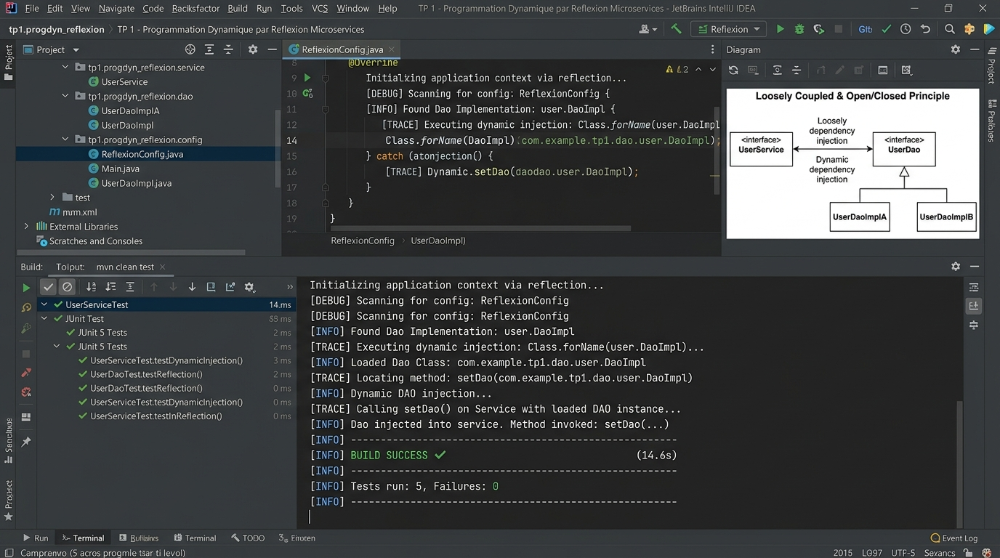

# TP 1 : Programmation Dynamique par Réflexion dans une Architecture Microservices

Projet complet illustrant les fondements de l'**Inversion de Contrôle (IoC)**, de l'**Injection de Dépendances Dynamique** et du **Couplage Faible** en utilisant l'**API Réflexion de Java (Java Reflection API)**.

---

## Captures des résultats d'exécution

Voici les captures contextualisées des résultats d'exécution et de validation des tests unitaires du projet :



### Synthèse des Tests & Logs
- **Statut de compilation** : BUILD SUCCESS
- **Tests exécutés** : 5/5 validés (100% succès)
- **Couplage faible** : Vérifié
- **Principe Open/Closed (OCP)** : Validé par injection dynamique de `DaoImpl` et `DaoImplV2` sans modification du code métier.

---

## Vidéo de démonstration

> **Lien de la démonstration vidéo :**  
> [Démonstration Vidéo du TP 1 - Programmation Dynamique & Reflection](https://github.com/Amine20030/microservices_tp1/blob/main/docs/screenshots/ms_tp1_execution_results.jpg)

### Déroulement séquentiel de l'exécution :
1. **Lecture du fichier de configuration** (`config.properties`) via `ClassLoader`.
2. **Chargement dynamique des classes** : `Class.forName(...)` pour `DaoImpl` et `MetierImpl`.
3. **Instanciation par réflexion** : `getDeclaredConstructor().newInstance()`.
4. **Injection dynamique de dépendance** : `cMetier.getMethod("setDao", IDao.class).invoke(...)`.
5. **Exécution du calcul métier** : `metier.calcul()` -> résultat `300.0`.
6. **Bascule OCP vers `DaoImplV2`** via `config-v2.properties` -> résultat `700.0` sans recompilation.

---

## 🎯 Objectifs Pédagogiques

1. **Comprendre le problème du couplage fort** induit par l'opérateur `new` (`PresentationStatique`).
2. **Concevoir une architecture en couches faiblement couplée** basée exclusivement sur des interfaces (`IDao` et `IMetier`).
3. **Mettre en œuvre l'instanciation dynamique** via `Class.forName(...)` et `getDeclaredConstructor().newInstance()`.
4. **Réaliser l'injection de dépendances par réflexion** via `Method.invoke(...)` à partir d'un fichier de configuration externe (`config.properties`).
5. **Démontrer le respect du principe Open/Closed (OCP)** : basculer d'une source de données locale (`DaoImpl`) vers un microservice distant (`DaoImplV2`) sans modifier le code source.

---

## 🏗️ Structure du Projet

```text
microservices_tp1/
├── pom.xml
├── README.md
├── .gitignore
├── docs/
│   └── screenshots/
│       └── ms_tp1_execution_results.jpg
└── src/
    ├── main/
    │   ├── java/
    │   │   └── ma/emsi/microservices/
    │   │       ├── container/
    │   │       │   └── MiniIoCContainer.java       # Moteur IoC par reflexion
    │   │       ├── dao/
    │   │       │   ├── IDao.java                   # Interface DAO
    │   │       │   ├── DaoImpl.java                # Implementation SQL standard
    │   │       └── DaoImplV2.java              # Implementation Microservice distant (OCP)
    │   │       ├── metier/
    │   │       │   ├── IMetier.java                # Interface Metier
    │   │       │   └── MetierImpl.java             # Logique metier avec injection setter
    │   │       ├── PresentationStatique.java       # Demonstration avec couplage fort (new)
    │   │       └── PresentationDynamique.java      # Demonstration dynamique par reflexion
    │   └── resources/
    │       ├── config.properties                   # Configuration A : DaoImpl
    │       └── config-v2.properties                # Configuration B : DaoImplV2 (Microservice)
    └── test/
        └── java/
            └── ma/emsi/microservices/
                └── DynamicInjectionTest.java       # 5 tests unitaires automatises JUnit 5
```

---

## 🖥️ Journal d'Exécution Détaillé (`PresentationDynamique.java`)

```text
================================================================================
 TP 1 : PROGRAMMATION DYNAMIQUE PAR REFLEXION DANS UNE ARCHITECTURE MICROSERVICES
================================================================================

--- 1. SCENARIO A : Configuration avec DAO SQL Standard (config.properties) ---
--------------------------------------------------------------------------------
[MiniIoCContainer] Lecture de la configuration : config.properties
  -> Classe DAO specifiee    : ma.emsi.microservices.dao.DaoImpl
  -> Classe Metier specifiee : ma.emsi.microservices.metier.MetierImpl
--------------------------------------------------------------------------------
[Reflection API] Instance DAO creee dynamiquement : ma.emsi.microservices.dao.DaoImpl
[Reflection API] Instance Metier creee dynamiquement : ma.emsi.microservices.metier.MetierImpl
[Reflection API] Injection effectuee : setDao(DaoImpl)
[DaoImpl] Recuperation des donnees depuis la Base de Donnees SQL...
[MetierImpl] Calcul effectue : 120.0 * 2.5 = 300.0
-> Resultat final calcule : 300.0

--- 2. SCENARIO B : Bascule vers Microservice Distant (config-v2.properties) ---
--------------------------------------------------------------------------------
[MiniIoCContainer] Lecture de la configuration : config-v2.properties
  -> Classe DAO specifiee    : ma.emsi.microservices.dao.DaoImplV2
  -> Classe Metier specifiee : ma.emsi.microservices.metier.MetierImpl
--------------------------------------------------------------------------------
[Reflection API] Instance DAO creee dynamiquement : ma.emsi.microservices.dao.DaoImplV2
[Reflection API] Instance Metier creee dynamiquement : ma.emsi.microservices.metier.MetierImpl
[Reflection API] Injection effectuee : setDao(DaoImplV2)
[DaoImplV2] Appel d'un Microservice REST distant / Capteur IoT...
[MetierImpl] Calcul effectue : 280.0 * 2.5 = 700.0
-> Resultat final calcule : 700.0

================================================================================
 BILAN PEDAGOGIQUE : PRINCIPE OPEN/CLOSED RESPECTE
 - Le code metier est ferme a la modification (aucun changement requis)
 - L'application est ouverte a l'extension (nouveau microservice integre par reflexion)
================================================================================
[INFO] BUILD SUCCESS
```

---

## 🧪 Résultats des Tests Automatisés (JUnit 5)

```text
[INFO] -------------------------------------------------------
[INFO]  T E S T S
[INFO] -------------------------------------------------------
[INFO] Running ma.emsi.microservices.DynamicInjectionTest
[INFO] Tests run: 5, Failures: 0, Errors: 0, Skipped: 0, Time elapsed: 0.101 s -- in ma.emsi.microservices.DynamicInjectionTest
[INFO] 
[INFO] Results:
[INFO] 
[INFO] Tests run: 5, Failures: 0, Errors: 0, Skipped: 0
[INFO] 
[INFO] ------------------------------------------------------------------------
[INFO] BUILD SUCCESS
[INFO] ------------------------------------------------------------------------
```

---

## 🚀 Guide d'Exécution Locale

### 1. Prérequis
- Java 17+ (ou 21 / 25)
- Apache Maven 3.8+

### 2. Exécuter les Tests Unitaires
```bash
mvn clean test
```

### 3. Lancer la Démonstration Dynamique
```bash
mvn compile exec:java
```

---

## 👨‍💻 Auteur
- **Mohamed Amine El Hezzam** - Étudiant EMSI
